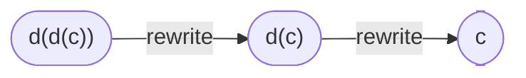
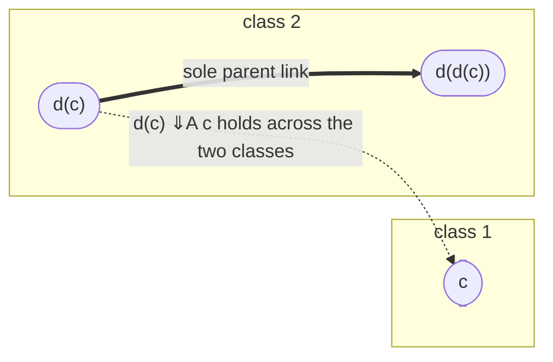
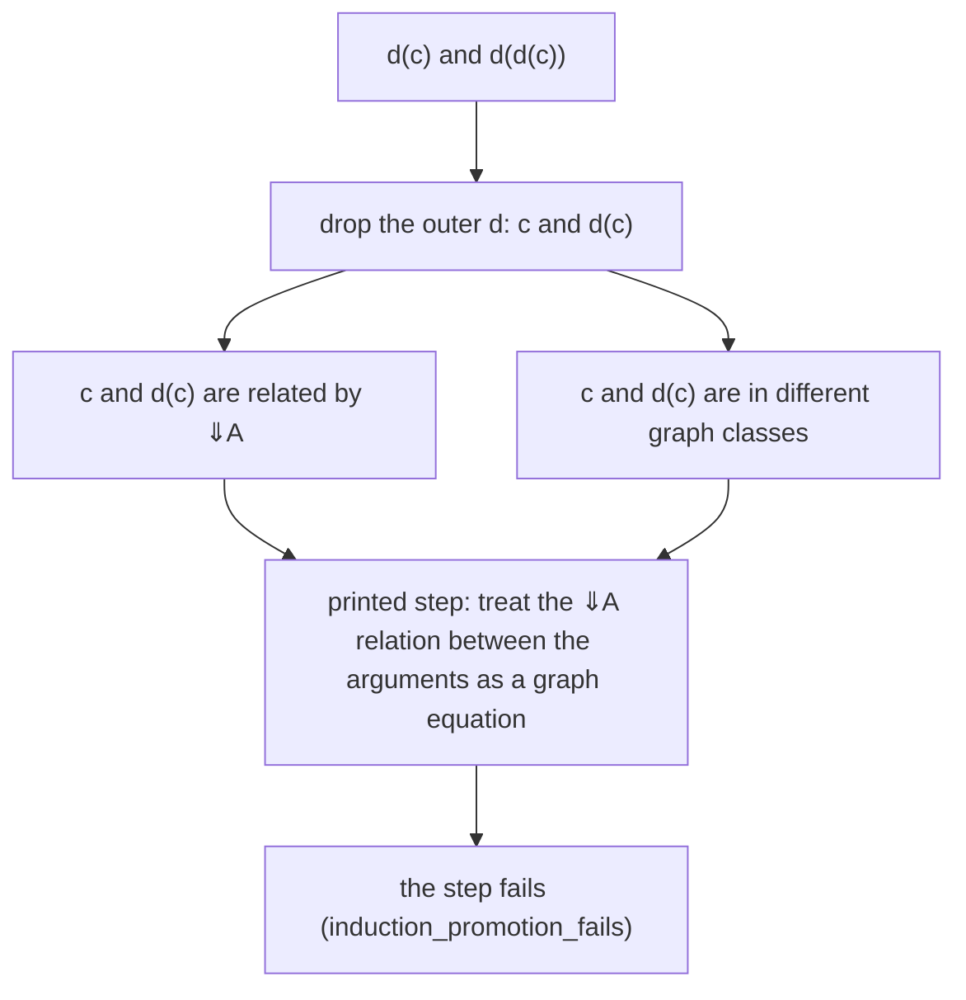
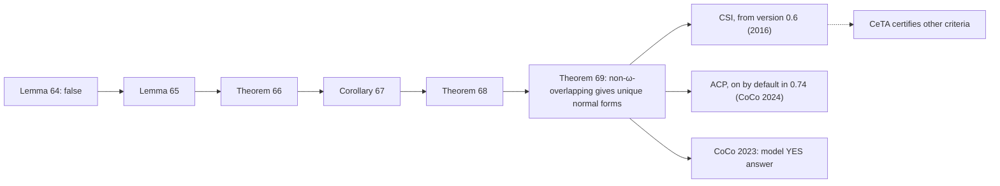
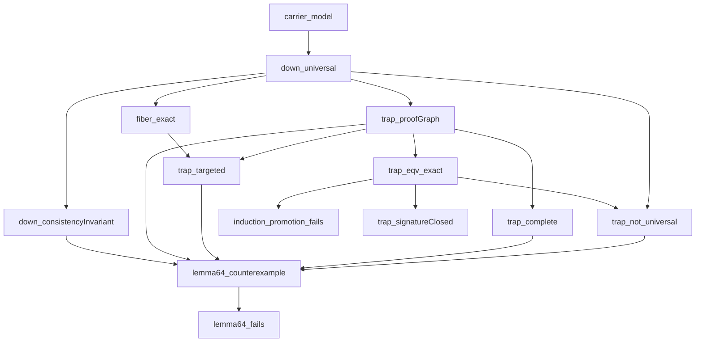

# RTA-79 Proof Counterexample

A Lean 4 proof that Lemma 64 of Kahrs and Smith, *Non-ω-Overlapping TRSs are UN* (FSCD 2016), is false.

Kahrs and Smith published their paper as the solution to Problem 79 on the RTA list of open problems: the conjecture that every non-ω-overlapping term rewriting system has unique normal forms. Their proof runs through Lemma 64, and Lemma 64 fails on a system with one rule, `d(x) → x`, and three terms. CSI and ACP, two automated provers, use the Kahrs and Smith theorem to answer questions about unique normal forms, and every answer justified by that theorem alone rests on a published proof that contains a false lemma.

**Paper.** Rahnama, Moses, *A counterexample to Lemma 64 of the Kahrs and Smith proof for RTA-79, and its implications for automated proofs of unique normal forms* (October 23, 2026). SSRN: <https://ssrn.com/abstract=7659838>, DOI [10.2139/ssrn.7659838](http://dx.doi.org/10.2139/ssrn.7659838).

**The refuted lemma.** Stefan Kahrs and Connor Smith, *Non-Omega-Overlapping TRSs are UN*, FSCD 2016, LIPIcs 52, [DOI 10.4230/LIPIcs.FSCD.2016.22](https://doi.org/10.4230/LIPIcs.FSCD.2016.22).

## Lemma 64

Kahrs and Smith prove unique normal forms with a *proof graph*. Each term in the graph has at most one parent, every chain of parents is finite, every link is of an allowed kind, and two terms count as equal in the graph if a path of parent links joins them. The graph is meant to capture ⇓A, the relation built in their Definitions 38 and 40. A graph whose equations coincide with ⇓A is called *universal*. Lemma 64 says:

> If ⇓A is a consistency invariant, then every complete targeted proof graph is universal.

*Complete* means every valid proof graph that contains it is equal to it. *Targeted* means each fiber, a set of terms whose arguments are linked by ⇓A, has one chosen target term, and the parent links lead toward it.

## The counterexample

Take the rule `d(x) → x` and the three terms `c`, `d(c)` and `d(d(c))`. Each `d`-term rewrites at the root by dropping its outer `d`:



⇓A relates every pair of the three terms (`down_universal`).

Now build the graph with one parent link, from `d(c)` to `d(d(c))`, and choose `d(d(c))` as the target of both `d`-terms. This graph meets every hypothesis of Lemma 64 and splits the three terms into two classes, `{c}` and `{d(c), d(d(c))}`. The equation `d(c) ⇓A c` crosses the two classes, so the graph is not universal.



| Part of Lemma 64 | Kahrs and Smith | On this graph | Lean theorem |
|---|---|---|---|
| ⇓A is a consistency invariant | Def. 30 | holds | `down_consistencyInvariant` |
| the links form a proof graph | Defs. 46, 51 | holds | `trap_proofGraph` |
| the graph is targeted | Defs. 57 to 59 | holds | `trap_targeted` |
| the graph is complete | Defs. 49, 54 | holds | `trap_complete` |
| the graph is universal (the conclusion) | Def. 63 | **fails** | `trap_not_universal` |

Lean proves all five facts for this one graph in a single theorem, and derives the negation of Lemma 64 from it:

```lean
theorem lemma64_counterexample :
    ConsistencyInvariant Down ∧ ProofGraph trap ∧ Targeted trap target ∧
      Complete trap ∧ ¬ Universal trap

theorem lemma64_fails :
    ¬ (ConsistencyInvariant Down → ∀ (rho : Rel) (q : Node → Node),
      Targeted rho q → Complete rho → Universal rho)
```

## The gap in the printed proof

The proof of Lemma 64 takes two `d`-terms whose arguments are related by ⇓A and treats that relation as if it were already an equation of the graph. The arguments of `d(c)` and `d(d(c))` are `c` and `d(c)`. These are related by ⇓A, and they sit in different classes of the graph (`induction_promotion_fails`).



The graph is closed under the signature (`trap_signatureClosed`): related arguments give related `d`-terms. The printed step needs the converse, from related `d`-terms back to their arguments, and `d(c)`, `d(d(c))` break it.

With `d(c)` as the target, the parent chain `d(d(c)) → d(c) → c` gives a universal graph on the same three terms (paper, Section 4), so the outcome depends on the choice of target.

## Consequences for automated provers

The provers use Theorem 69 of Kahrs and Smith: every non-ω-overlapping system has unique normal forms. Its printed proof reaches Lemma 64 through Theorem 68, Corollary 67, Theorem 66 and Lemma 65 (Section 4 of the paper).



| Use of the theorem | Source |
|---|---|
| CSI 0.6 lists the Kahrs and Smith criterion for unique normal forms | CoCo 2016 participant description, IWC 2016, p. 84 |
| CSI 1.0 states it as Theorem 8 and uses it for non-ground systems | Nagele, Felgenhauer, Middeldorp, CADE 26, LNAI 10395, pp. 388 to 389 |
| CeTA's list of certifiable criteria omits it | same report, p. 392 |
| On 242 Cops problems, the criterion alone proves unique normal forms for 10 | Aoto and Toyama, FroCoS 2019, full version, Table 1 |
| ACP 0.74 has it on by default and answers YES once it confirms the system is non-ω-overlapping | ACP 0.74 source, `src/rwchecker/unc.sml` |
| The 2023 competition page gives a model YES answer justified by Kahrs and Smith | <https://project-coco.uibk.ac.at/2023/categories/unc.php> |

## Lean proof structure

Each arrow runs from a result to a result that uses it.



| Kahrs and Smith | Lean |
|---|---|
| Def. 5: terms, and the root rewrites of `d(x) → x` | `Term`, `Node`, `term`, `Root`, `carrier_model` |
| Defs. 24, 25: closure under the signature | `SignatureClosed`, `CT`, `ct_spec` |
| Defs. 27, 30: constructor compatibility, consistency invariant | `ConstructorCompatible`, `ConsistencyInvariant` |
| Defs. 38, 40: ⇓A as a least fixed point | `Down`, `DownStep`, `down_least_fixed_point` |
| Defs. 46, 51: proof graphs and their allowed links | `Eqv`, `Grey`, `ProofGraph` |
| Defs. 49, 54: completeness | `Complete` |
| Defs. 57 to 59: fibers, targets, targeted graphs | `Fiber`, `Target`, `Targeted` |
| Def. 63: universality | `Universal` |
| Lemma 64 | `lemma64_counterexample`, `lemma64_fails` |

## Build

Lean 4 `v4.22.0-rc4`, pinned in `lean-toolchain`. The file imports Lean's core library alone.

```console
lake build
lake env lean Lemma64.lean
```

The end of the file runs `#check` and `#print axioms` on all 69 public declarations, constructors and fields: 55 depend on zero axioms, and the other 14 on `propext` and `Quot.sound` alone.

## License

Apache License 2.0: [`LICENSE`](LICENSE). Copyright (c) 2026 Moses Rahnama / Mina Analytics.

## Citation

```bibtex
@misc{Rahnama2026Lemma64,
  author       = {Rahnama, Moses},
  title        = {A counterexample to Lemma 64 of the Kahrs and Smith proof for {RTA}-79, and its implications for automated proofs of unique normal forms},
  year         = {2026},
  month        = oct,
  howpublished = {SSRN 7659838},
  doi          = {10.2139/ssrn.7659838},
  url          = {https://ssrn.com/abstract=7659838}
}
```
